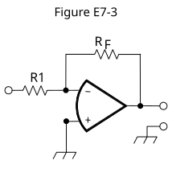

### Section 3.3: Operational Amplifiers

In the previous section, R3 used negative feedback to hold one transistor's bias steady. An **operational amplifier**, or **op-amp**, puts feedback at the center of the design. On its own, the chip has far more gain than most circuits can use, often 100,000 or more. A few external parts in a feedback path set the working gain instead.

#### Amplifying a Difference

An op-amp's triangle symbol shows two inputs. A positive change at the non-inverting (+) input drives the output positive. A positive change at the inverting (−) input drives the output negative. The amplifier responds to the voltage difference between those inputs. Its stages connect directly, without coupling capacitors, so it can amplify DC as well as changing signals. Its inputs draw almost no current from the signal source, and its output holds its voltage while supplying load current within its rating.

> **Key Information:** An operational amplifier is a high-gain, direct-coupled differential amplifier with very high input impedance and very low output impedance.   

Direct coupling has a cost: the op-amp amplifies DC errors as readily as DC signals. Tiny mismatches in its input stage act like a small voltage between the inputs. Even with both inputs at the same voltage, that error pushes the output toward one limit. The effect is strongest with no feedback connected, a condition called **open loop**. The error may be only a millivolt, but with a 1 mV signal, that is as large as the signal itself.

> **Key Information:** Op-amp input offset voltage is the differential input voltage needed to bring the open-loop output voltage to zero. 

At high frequencies, gain runs out. Quick calculations use an **ideal op-amp**, a model that leaves this limit out. A real op-amp's open-loop gain is enormous at low frequencies but falls steadily as frequency rises, until it reaches one, or unity, at the **unity-gain frequency**. Along that slope, gain times frequency stays nearly constant for most op-amps, and that product is called the **gain-bandwidth**. At the bottom of the slope the gain is one, so there the product is just the frequency.

The product sets a trade. An op-amp with a gain-bandwidth of 1 MHz can provide a gain of 100 up to about 10 kHz, or a gain of 10 up to about 100 kHz. Ask a feedback circuit for more gain, and it keeps up over a narrower range of frequencies.

![A graph with logarithmic scales plots voltage gain, from 1 to 100,000, against frequency, from 1 Hz to 10 MHz. A solid blue line for open-loop gain runs level at 100,000 to 10 Hz, then falls steadily, reaching a gain of 1 at 1 MHz, where a dot marks the unity-gain frequency. A dashed orange line for a circuit with a gain of 100 runs level until it meets the blue line at 10 kHz; a dotted green line for a gain of 10 runs level until it meets the blue line at 100 kHz. Dashed guides drop from each meeting point to the frequency axis. At frequencies beyond each meeting point, the circuit's gain follows the falling open-loop line. Each meeting point multiplies to the same 1 MHz: 100 times 10 kHz, and 10 times 100 kHz.](../../../images/s3-3-gain-bandwidth.svg)
{.img-centered .img-xlarge .img-mobile-full caption="A real op-amp's open-loop gain falls with frequency to 1 at its unity-gain frequency, here 1 MHz. A feedback circuit's gain stays level only until it meets that line, so higher gain leaves less bandwidth."}

> **Key Information:**
> - The gain of an ideal operational amplifier does not vary with frequency. 
> - The gain-bandwidth of an operational amplifier is the frequency at which the open-loop gain of the amplifier equals one. 

#### The Inverting Circuit

To set the gain with resistors, Figure E7-3 returns part of the output to the inverting input through $R_F$. $R_1$ carries the input signal to that same point, while the non-inverting input connects to ground.

{.img-centered .img-xlarge .img-bw caption="Figure E7-3: Negative feedback sets the inverting gain."}

If the inverting-input voltage rises above zero, the op-amp drives its output negative. Through $R_F$, that pulls the inverting input back toward zero. While the amplifier operates linearly, negative feedback holds that input nearly at the grounded input's voltage. We call this a **virtual ground**: the voltage is near ground, but it is not a physical ground connection that can absorb arbitrary current.

Very little current enters the op-amp input, so current arriving through $R_1$ must leave through $R_F$. One end of $R_1$ is at the input voltage and the other is near zero, so its current is approximately $E_{\mathrm{in}}/R_1$. For a positive input, that same current continues through $R_F$ from the virtual-ground node toward the output. That puts the output below zero by the current multiplied by $R_F$:

$$E_{\mathrm{out}}=-\frac{E_{\mathrm{in}}}{R_1}\times R_F.$$

Dividing both sides by $E_{\mathrm{in}}$ gives the voltage gain:

$$A_v=\frac{E_{\mathrm{out}}}{E_{\mathrm{in}}}=-\frac{R_F}{R_1}.$$

The minus sign means inversion. **Absolute gain** is the magnitude without the sign. Before dividing, put both resistors in the same units. Otherwise a kilohm-to-ohm mismatch can make your answer a thousand times too small or too large.

| $R_1$ | $R_F$ | Absolute gain, $R_F/R_1$ |
| --- | --- | --- |
| 10 Ω | 470 Ω | $470/10=47$ |
| 1,800 Ω | 68 kΩ = 68,000 Ω | $68{,}000/1{,}800=37.78$ |
| 3,300 Ω | 47 kΩ = 47,000 Ω | $47{,}000/3{,}300=14.24$ |
{.table-scroll}

To find an output voltage, keep the sign. With $R_1 = 1{,}000\ \Omega$ and $R_F = 10{,}000\ \Omega$, the gain is −10. Applying +0.23 V gives $E_{\mathrm{out}}=-10\times0.23\ \mathrm{V}=-2.3\ \mathrm{V}$.

> **Key Information:** For the circuit in Figure E7-3:
> - When $R_1$ is 10 ohms and $R_F$ is 470 ohms, the voltage gain is 47. 
> - When $R_1$ is 1,800 ohms and $R_F$ is 68 kilohms, the absolute voltage gain is about 38. 
> - When $R_1$ is 3,300 ohms and $R_F$ is 47 kilohms, the absolute voltage gain is about 14. 
> - When $R_1$ is 1,000 ohms, $R_F$ is 10,000 ohms, and 0.23 volts DC is applied to the input, the output voltage is −2.3 volts. 

#### Frequency-Dependent Feedback

If we want less gain at high frequencies, the feedback path can do the filtering. Place a capacitor across $R_F$. Its high reactance at low frequencies leaves the resistor to set gain. At higher frequencies its reactance falls and the effective feedback impedance decreases. Since gain magnitude depends on feedback impedance divided by R1, gain falls with frequency.

More elaborate op-amp filters can resonate like a tuned circuit, even with no inductor, and have a Q of their own. A sudden input can start a fading oscillation called **ringing**: a brief click may leave a short tone behind it. Excessive Q makes that response linger. Gain also matters because internal phase shifts can turn intended negative feedback into reinforcement and make the filter unstable.

> **Key Information:**
> - With a capacitor added across the feedback resistor, the circuit in Figure E7-3 has a low-pass filter frequency response. 
> - Restricting both gain and Q prevents unwanted ringing and audio instability in an op-amp audio filter. 

The gain-bandwidth limit applies to filters too: a design that needs high gain at a high frequency may ask for more than the op-amp can give.
